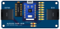
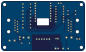
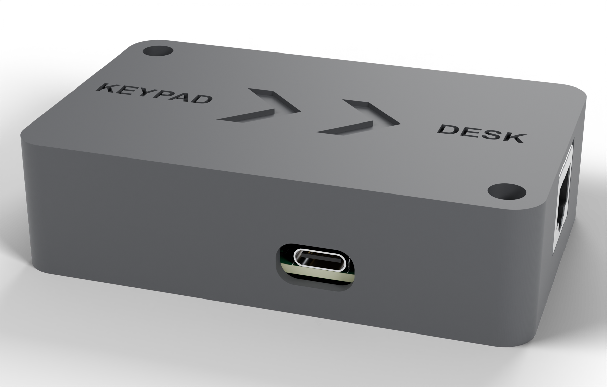

# esphome-kaidi-desk

[](https://github.com/clintval/esphome-kaidi-desk/actions/workflows/ci.yml?query=branch%3Amain)
[](https://esphome.io/components/external_components.html)
[](LICENSE)

Control a Kaidi standing desk from Home Assistant with an ESP32 and ESPHome.

<p align="center">
  
  
</p>

## Introduction

Many "K Series" and other budget standing desks run on a Kaidi control box, such as the `KDDY094`.
The box talks to its keypad over a 9600 baud serial link on a 10-pin RJ50 cable, and no off-the-shelf smart-desk dongle speaks its protocol.
This component reads the desk's height and drives it the way the keypad does: it raises the keypad's wake line to power the motors, waits for the box to settle, then streams Up, Down and Reset commands.
Earlier Kaidi projects only listened to the box; moving the desk needed the wake line on contact 10, which an 8-pin RJ45 plug cannot reach.

## Quick Start

Add the component to an ESPHome config and wire the dongle as in [Hardware](#hardware):

```yaml
external_components:
  - source: github://clintval/esphome-kaidi-desk@main
    components: [kaidi_desk]

uart:
  rx_pin: GPIO4
  tx_pin: GPIO7
  baud_rate: 9600

kaidi_desk:
  tx_enable_pin: GPIO6
  wake_pin: GPIO10
  keypad_sense_pin: GPIO3

sensor:
  - platform: kaidi_desk
    height:
      name: Height

number:
  - platform: kaidi_desk
    target_height:
      name: Target Height
      unit_of_measurement: in
```

A complete config for an ESP32-C3 SuperMini, with every entity, is in [`example/kaidi-desk.yaml`](example/kaidi-desk.yaml).
Once flashed, the board appears in Home Assistant through the ESPHome integration.

## Entities

| Platform | Key | Purpose |
| --- | --- | --- |
| `sensor` | `height` | Height above the desk's lowest point, in cm (Home Assistant converts units) |
| `text_sensor` | `status` | `Ready`, `Reset Needed` (E04), `Resetting`, or `Asleep` |
| `number` | `target_height` | Move to a height; follows the real height while idle, in `cm` or `in` |
| `button` | `nudge_up`, `nudge_down` | Move briefly up or down, about half an inch |
| `button` | `stop` | Stop any move |
| `button` | `reset` | Hold Up and Down until the box re-zeros, which clears E04 |
| `switch` | `keep_awake` | Hold the wake line high so height streams live and moves start at once |

## Hardware

The dongle sits inline between the keypad and the control box: the keypad plugs into the RJ50 jack on one end, and a short straight-through 10P10C cable runs from the jack on the other end to the box.
Power, ground and the height stream pass straight through.
The keypad's command and wake lines reach the box through 1 kΩ resistors, and a 74AHCT125, powered from the desk's 5 V, drives the box side only while the ESP is sending.
Its two spare gates hold the driving gates off unless the ESP raises GPIO6 or GPIO10, so the keypad keeps working when the ESP is unplugged, rebooting or dead.
Dividers bring the box's 5 V height stream and the keypad's command line down to about 3.1 V for GPIO4 and GPIO3, so a keypad press hands the desk straight back to you.

<p align="center">
  
  
</p>

<p align="center">
  
  
</p>

<p align="center">
  
</p>

| RJ50 contact | Signal | Path |
| --- | --- | --- |
| 2 | +5 V | Straight through; also powers the 74AHCT125 |
| 3 | Ground | Straight through |
| 7 | Command, keypad to box | Keypad through 1 kΩ; gate A drives the box side from GPIO7 when GPIO6 is high |
| 8 | Height, box to keypad | Straight through; 10 kΩ over 15 kΩ to GPIO4 |
| 10 | Wake, keypad to box | Keypad through 1 kΩ; gate B drives the box side high when GPIO10 is high |

The board is an 84 × 40 mm two-layer KiCad design in [`hardware/`](hardware), with all parts through-hole and everything flat: the two Amphenol/FCI 54602-910LF right-angle jacks face out of opposite ends, and the ESP32-C3 SuperMini sits between them, soldered flat to the board on its header pins with the plastic spacers slid off, its USB-C port facing out of the side.
Under the C3's antenna the board has no copper on either layer and a routed slot, so the antenna sits over air rather than a ground pour.
The ground pads join the ground pours solidly rather than through thermal spokes, so give them a little extra heat when soldering.
The C3 runs from its own USB-C port: the 5 V on the keypad port is a small logic supply for the keypad, and it browns out under the C3's Wi-Fi current.
Upload [`hardware/kaidi-desk-gerbers.zip`](hardware/kaidi-desk-gerbers.zip) to a board house such as JLCPCB to order it.
The jack footprint follows FCI drawing C-BMJ-0101 rev F; confirm pin 1 against your jacks before ordering.

## Enclosure

A two-part box for 3D printing is in [`hardware/enclosure/`](hardware/enclosure) as STEP and STL, generated by [`scripts/make_enclosure.py`](scripts/make_enclosure.py) from the board's real outline, jack and USB-C positions.
It measures about 89 × 45 × 24 mm, with the keypad jack in one end wall, the desk jack in the other, USB-C in the side and two screw ears for mounting under the desk.
The board sits on four posts, and two M3 × 20 mm button-head screws pass through the lid's bosses and the board into M3 heat-set inserts in the base, clamping everything.
The screw heads sit flush in the lid, and each screw engages 4.1 mm of its insert; the script checks that stack whenever the box changes.
The screws sit in the corners away from the C3's antenna, which faces only plastic.

<p align="center">
  
  
</p>

To assemble it, press the two inserts into the base's corner posts with a soldering iron at about 220 °C, set the board on the posts, lay the lid on and drive the two screws.

Print it in MJF nylon (PA12) from a service such as JLCPCB's 3D printing, which can ship in the same order as the PCB.
Nylon holds heat-set inserts well and keeps the jack and USB-C openings to about 0.1 mm; avoid SLA resin, which tends to crack around inserts.
On an FDM printer, use PETG or ASA and widen the openings by 0.2 mm in the script if the jacks bind.

## Bill of Materials

| Qty | Part | Where to order |
| --- | --- | --- |
| 1 | PCB, 84 × 40 mm, 2 layers, 1.6 mm | [JLCPCB](https://jlcpcb.com/): upload [`hardware/kaidi-desk-gerbers.zip`](hardware/kaidi-desk-gerbers.zip) |
| 1 | Enclosure base and lid, MJF nylon (PA12) | [JLCPCB 3D printing](https://jlcpcb.com/3d-printing): upload [`base.stl`](hardware/enclosure/base.stl) and [`lid.stl`](hardware/enclosure/lid.stl) |
| 2 | Amphenol/FCI 54602-910LF, 10P10C right-angle jack (J1, J2) | [DigiKey](https://www.digikey.com/en/products/detail/amphenol-cs-fci/54602-910LF/1001361) |
| 1 | SN74AHCT125N quad buffer, DIP-14 (U2) | [DigiKey](https://www.digikey.com/en/products/result?keywords=SN74AHCT125N) |
| 1 | DIP-14 socket, 0.3 in (optional) | [DigiKey](https://www.digikey.com/en/products/result?keywords=DIP-14%20socket%200.3) |
| 1 | ESP32-C3 SuperMini with header pins (U1) | [Amazon](https://www.amazon.com/s?k=ESP32-C3+SuperMini) or [AliExpress](https://www.aliexpress.us/w/wholesale-esp32-c3-supermini.html) |
| 2 | 1 kΩ, 1/4 W (R1, R2) | [DigiKey CF14JT1K00](https://www.digikey.com/en/products/result?keywords=CF14JT1K00) |
| 4 | 10 kΩ, 1/4 W (R3, R4, R7, R9) | [DigiKey CF14JT10K0](https://www.digikey.com/en/products/result?keywords=CF14JT10K0) |
| 2 | 100 kΩ, 1/4 W (R5, R6) | [DigiKey CF14JT100K](https://www.digikey.com/en/products/result?keywords=CF14JT100K) |
| 2 | 15 kΩ, 1/4 W (R8, R10) | [DigiKey CF14JT15K0](https://www.digikey.com/en/products/result?keywords=CF14JT15K0) |
| 1 | 100 nF ceramic, 2.5 mm lead pitch (C1) | [DigiKey](https://www.digikey.com/en/products/result?keywords=100nF%2050V%20ceramic%20radial%202.5mm) |
| 1 | RJ50 (10P10C) cable, 0.25 m, wired straight through, dongle to control box | [Delock 80185](https://www.delock.com/produkt/80185/merkmale.html) |
| 2 | M3 × 20 mm button-head screw, ISO 7380 | [Amazon](https://www.amazon.com/s?k=M3x20+button+head+screw+ISO+7380) |
| 2 | M3 heat-set insert, 5.7 mm long, 4.0 mm hole (ruthex M3) | [Amazon](https://www.amazon.com/s?k=ruthex+M3+heat+set+inserts) |

JLCPCB can ship the board and the printed box in one order.
The cable to the control box must be wired straight through, pin 1 to pin 1, like a network patch cable; flat telephone-style 10P10C cables are often reversed, which mirrors every contact.
Delock's RJ50 cables are round, shielded and straight through, and also come in 0.5 m and 1 m.

## Build Without a PCB

Rev 4 is the same inline, fail-safe circuit hand-built on a 1.5 × 2 in EPLZON solderable breadboard, with a Bipom BRK10P10CSJ breakout for the keypad and a cut 10P10C cable to the desk.
Every part, jumper and wire has a named hole, and [`scripts/protoboard.py`](scripts/protoboard.py) checks the layout's connections against the circuit.

<p align="center">
  
</p>

On this build, configure `tx_enable_pin: GPIO6`, `wake_pin: GPIO0` and `rx_pin: GPIO3`, and leave out `keypad_sense_pin`.

## Protocol

Each frame is 7 bytes, `0x68 0x01 <mode> <hi> <lo> <checksum> 0x16`, where the checksum is the low byte of `0x01 + mode + hi + lo`.

| Direction | Mode | Meaning |
| --- | --- | --- |
| Keypad to box | `0x01` | Up |
| Keypad to box | `0x02` | Down |
| Keypad to box | `0x03` | Idle |
| Keypad to box | `0x04` | Up and Down held (reset) |
| Box to keypad | `0x00` | Height in 0.1 cm |
| Box to keypad | `0x30` | Reset needed (E04); the value counts down during the reset |
| Box to keypad | `0x04` | Reset rebound in progress |

The keypad sends a frame every 14 ms while awake.
The box answers about 0.6 s after it wakes, ignores moves for about 1 s more, and needs Up held about 0.4 s before the motors start.
It displays E04 when a reset is released before the rebound.

## Development and Testing

See the [contributing guide](./CONTRIBUTING.md) for more information.

## Acknowledgements

The frame format was first decoded in [`xvzf/kaidi-desk-controller-protocol`](https://github.com/xvzf/kaidi-desk-controller-protocol), and [`jcappaert/esphome-kaidi`](https://github.com/jcappaert/esphome-kaidi) read the height on the same `KDDY094` box.

## License

MIT
