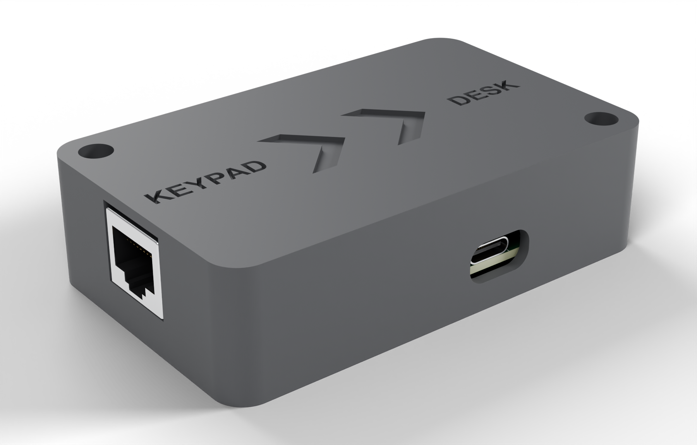
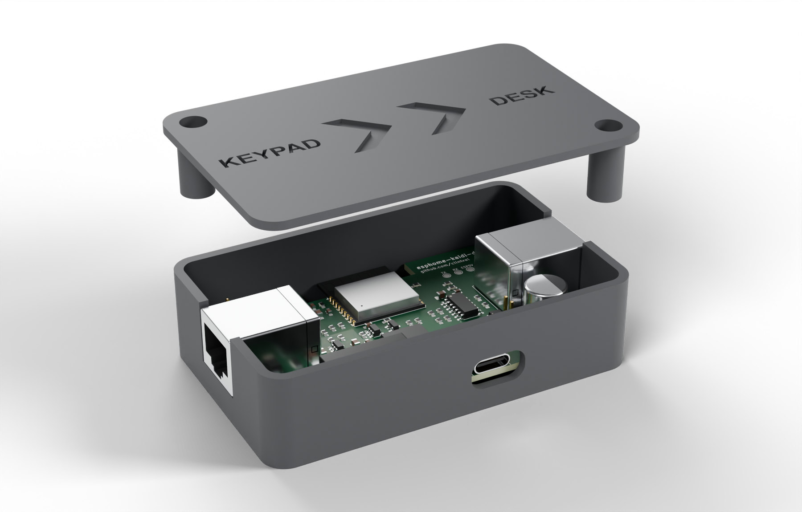

# esphome-kaidi-desk

[](https://github.com/clintval/esphome-kaidi-desk/actions/workflows/ci.yml?query=branch%3Amain)
[](https://esphome.io/components/external_components.html)
[](LICENSE)

Control a Kaidi standing desk from Home Assistant with an ESP32 and ESPHome.

<p align="center">
  
  
</p>

## Introduction

Many budget electric standing desks, sit-stand desks and desk frames run on a control box from Kaidi (Changzhou Kaidi Electrical), such as the `KDDY094`, which talks to its keypad over 9600 baud serial on a 10-pin RJ50 cable.
This component reads the desk's height and moves it the way the keypad does, including the reset that clears E04.

To check your desk, look for a `KAIDI` label and a `KDDY` model number on the control box under the desktop.

| Desk | Control box | Status |
| --- | --- | --- |
| ApexDesk K Series 3-stage dual-motor desk base | `KDDY094` | Tested |
| Other desks with a `KDDY094` box (variants S500, S650 and S663) | `KDDY094` | Expected to work |
| Lazy Maisons desk (2021) with a `KDH170-311` keypad | `KDDY094`, S440, `DY094-409/000838A 06-V2.5` | Expected to work: [`yog18r/kaidi-desk-esphome`](https://github.com/yog18r/kaidi-desk-esphome) measured the same contacts and frames, but this dongle hasn't been tried on it; set the target height's `max_value` to 44 cm (17.3 in) |
| Desks with a `KDDY041` box and `KD1869A` keypad | `KDDY041` | Same protocol, but an 8-pin cable, so the dongle won't fit |

If your desk works, please open an issue or pull request to add it.

## Quick Start

With an assembled board, open the [browser installer](https://clintval.github.io/esphome-kaidi-desk/) in Chrome or Edge, plug in its USB-C and follow the steps. It goes live with the first release.
The prebuilt firmware holds no secrets: Wi-Fi is set over USB, Home Assistant sets the encryption key within 15 minutes of power-up, and updates only come over HTTPS from this repository's releases.

To build your own firmware instead, use the component in an ESPHome config, wired as in [Hardware](#hardware):

```yaml
external_components:
  - source: github://clintval/esphome-kaidi-desk@main
    components: [kaidi_desk]

uart:
  - id: desk_uart
    rx_pin: GPIO4
    tx_pin: GPIO7
    baud_rate: 9600
  - id: keypad_uart
    rx_pin: GPIO3
    baud_rate: 9600

kaidi_desk:
  uart_id: desk_uart
  keypad_uart_id: keypad_uart
  tx_enable_pin: GPIO6
  wake_pin: GPIO10
  keypad_cutoff_pin: GPIO1

sensor:
  - platform: kaidi_desk
    height:
      name: Height

number:
  - platform: kaidi_desk
    target_height:
      name: Target Height
      unit_of_measurement: in
```

A complete config is in [`example/kaidi-desk.yaml`](example/kaidi-desk.yaml), which takes the board and every entity from [`example/desk.yaml`](example/desk.yaml).
It encrypts the Home Assistant connection and Wi-Fi updates with one key, and puts a password on the fallback hotspot. Add `wifi_ssid`, `wifi_password`, `ap_password` and `api_encryption_key` to your `secrets.yaml`; the `openssl rand -base64 32` command makes a key.

## Entities

| Platform | Key | Purpose |
| --- | --- | --- |
| `sensor` | `height` | Height above the desk's lowest point, in cm (Home Assistant converts units) |
| `text_sensor` | `status` | `Ready`, `Reset Needed` (E04), `Resetting`, `Keypad Settings`, or `Asleep` |
| `text_sensor` | `last_stop` | Why the last move ended, such as `Reached target`, `Reached preset 2`, `Stopped`, `Stopped short at a limit or obstruction` `Keypad took over` or `Lost the height`; also the result of a preset save, and what the keypad did, such as `Keypad moved the desk up`, `Keypad went to preset 2` or `Keypad saved preset 3` |
| `text_sensor` | `keypad` | What the keypad is doing: `Asleep`, `Awake`, `Up`, `Down`, `Preset 1` to `Preset 4`, or `Reset`; needs `keypad_uart_id` |
| `number` | `target_height` | Move to a height; follows the real height while idle, in `cm` or `in` |
| `button` | `nudge_up`, `nudge_down` | Move briefly up or down, about half an inch |
| `button` | `stop` | Stop any move |
| `button` | `preset_1` to `preset_4` | Go to a position saved on the keypad; the box drives there and stops by itself |
| `button` | `save_preset_1` to `save_preset_4` | Replace a preset with the current height, once the desk is still; the box sends no confirmation, and presets can't be read back |
| `button` | `reset` | Hold Up and Down until the box re-zeros, which clears E04; it ignores other moves until it finishes, and may clear the keypad's presets |
| `switch` | `keep_awake` | Hold the wake line high and send an Idle frame every 4 s, inside the box's 10 to 12 s sleep timer, so the box stays awake, height streams live and moves start at once |

## Hardware

> [!WARNING]
> This board is untested: none has been built yet, and the desk-power test and a check of the jacks' contact order are still pending, so don't order boards from it yet.
> The protoboard build, under "Build without a PCB" below, is tested and works.

The dongle sits inline: the keypad plugs into one end, and a short cable runs from the other end to the control box.
A 74AHCT125 drives the box only while the ESP is sending, so the keypad keeps working if the ESP is unpowered, resetting or unplugged.
The ESP also decodes what the keypad sends, and keeps listening while it cuts the keypad off, so a keypad press takes over from a Home Assistant move at once.
Power comes from the desk by default. USB-C is for flashing and for desks that can't supply the ESP, and it is isolated, so any charger or computer can stay plugged in.

<p align="center">
  
  
</p>

<details>
<summary>Schematic</summary>

<p align="center">
  
</p>

</details>

| RJ50 contact | Signal | Path |
| --- | --- | --- |
| 2 | +5 V | Straight through; also powers the 74AHCT125 and, through JP1, the ESP |
| 3 | Ground | Straight through |
| 7 | Command, keypad to box | Keypad through switch U9 and 1 kΩ; gate A drives the box side through 47 Ω from GPIO7 when GPIO6 is high. GPIO1 high opens U9 and cuts the keypad off; a shunt on JP2 bypasses U9 |
| 8 | Height, box to keypad | Straight through; 100 kΩ over 150 kΩ to GPIO4 |
| 10 | Wake, keypad to box | Keypad through 1 kΩ; gate B drives the box side high through 47 Ω when GPIO10 is high |
| 1, 4, 5, 6, 9 | Unused by this dongle | Straight through |

The board is an 84 × 50 mm, four-layer KiCad design in [`hardware/`](hardware), made to be assembled by a board house.
Every part is fitted by the board house, including the jacks, whose metal shells are tied to the desk's ground and sit flush with the box.

| Situation | Protection |
| --- | --- |
| Two-prong charger or noisy dock leaking mains AC, which makes touch keypads barely register a press | USB-C power (B0505S-2WR3) and data (ADuM3160) both cross isolation barriers, with a 3 mm moat on all four layers |
| Weak desk 5 V | 1000 µF reserve; otherwise pull JP1 and use USB-C |
| Desk and USB-C connected together | One Schottky diode each, so neither feeds back into the other |
| Short circuit on the board | Resettable fuses on the desk (F1) and USB-C (F2) supplies; F1 doesn't cover the keypad's own straight-through 5 V |
| USB hot-plug spikes and converter light load, which the B0505S-2WR3 isn't rated for | Surge clamp D4 at its input and preload R14 at its output |
| Static on the cables | SRV05-4 clamps at both jacks and a USBLC6-2 at USB-C |
| ESP crash, reset or power loss | Pull-downs turn the drivers off and reconnect the keypad, and ESPHome's watchdog restarts a hung ESP |
| ESP and keypad driving the box at once | U9 cuts the keypad off during a move, and the ESP still listens to it; 1 kΩ and 47 Ω limit the current otherwise |

It can't protect against a fault in the control box, the keypad or the cable, and it relies on the box's own anti-collision stop.
The isolation keeps grounds apart; it is not a safety barrier against mains.

<details>
<summary>Build without a PCB</summary>

The protoboard build is the same circuit hand-built on a 1.5 × 2 in EPLZON solderable breadboard, with a Bipom BRK10P10CSJ breakout for the keypad and a cut 10P10C cable to the desk.

> [!IMPORTANT]
> Power the protoboard build from a grounded (three-prong) USB charger, a computer's USB port or a power bank.
> It has no isolated power input, so a two-prong charger leaks a little mains AC onto the desk's ground and touch-sensitive keypads barely register a press.

<p align="center">
  
</p>

On this build, configure `tx_enable_pin: GPIO6`, `wake_pin: GPIO0` and `rx_pin: GPIO3`, and leave out `keypad_uart_id`, `keypad_cutoff_pin` and the second uart.

</details>

## Enclosure

A two-part, 89 × 55 × 24 mm box is in [`hardware/enclosure/`](hardware/enclosure) as STEP and STL, sized to sit in the desk's cable tray beside the control box.
The USB-C opening is on the long side. RESET, BOOT and JP1 are inside.

<p align="center">
  
  
</p>

Press the two heat-set inserts into the base with a soldering iron at about 220 °C, set the board on its posts, and screw the lid down with two M3 × 20 mm socket-head cap screws, which sit flush in the lid.
Print it in MJF nylon or, at home, PETG; resin tends to crack around the inserts.

## Bill of Materials

| Qty | Part | Where to order |
| --- | --- | --- |
| 1 | PCB, 84 × 50 mm, 4 layers, 1.6 mm, all parts fitted on the top side | [JLCPCB](https://jlcpcb.com/): upload [`kaidi-desk-gerbers.zip`](hardware/kaidi-desk-gerbers.zip), then [`kaidi-desk-bom.csv`](hardware/kaidi-desk-bom.csv) and [`kaidi-desk-positions.csv`](hardware/kaidi-desk-positions.csv) |
| 1 | Enclosure base and lid, MJF nylon (PA12) | [JLCPCB 3D printing](https://jlcpcb.com/3d-printing): upload [`base.stl`](hardware/enclosure/base.stl) and [`lid.stl`](hardware/enclosure/lid.stl) |
| 1 | Jumper shunt, 2.54 mm (JP1) | Any |
| 1 | RJ50 (10P10C) cable, about 1 ft, wired straight through, dongle to control box | [Winford CBM10R1TS-1](https://www.winford.com/products/cbm10.php) (US) or [Delock 80185](https://www.delock.com/produkt/80185/merkmale.html) (EU) |
| 2 | M3 × 20 mm socket-head cap screw, ISO 4762 | [Amazon](https://www.amazon.com/s?k=M3x20+socket+head+cap+screw+ISO+4762+stainless) |
| 2 | M3 heat-set insert, 5.7 mm long, 4.0 mm hole (ruthex M3) | [Amazon](https://www.amazon.com/s?k=ruthex+M3+heat+set+inserts) |

The parts the board house fits are listed in [`scripts/parts.py`](scripts/parts.py) with their LCSC numbers.
In the assembly preview, check the rotation of every chip, diode, LED and C4 before ordering: board houses often rotate parts differently from KiCad.

The cable must be wired straight through; flat telephone-style 10P10C cables are often reversed.

## Protocol

Each frame is 7 bytes, `0x68 0x01 <mode> <hi> <lo> <checksum> 0x16`, where the checksum is the low byte of `0x01 + mode + hi + lo`.

| Direction | Mode | Meaning |
| --- | --- | --- |
| Keypad to box | `0x01` | Up |
| Keypad to box | `0x02` | Down |
| Keypad to box | `0x03` | Idle |
| Keypad to box | `0x04` | Up and Down held (reset) |
| Keypad to box | `0x06` to `0x09` | Go to preset 1 to 4, repeated until the box stops; the height bytes are zero |
| Keypad to box | `0x0A`, `0x0B`, `0x0C`, `0x17` | Save the current height as preset 1 to 4, sent once |
| Box to keypad | `0x00` | Height in 0.1 cm |
| Box to keypad | `0x30` | Reset needed (E04); the value counts down during the reset |
| Box to keypad | `0x04` | Reset rebound in progress |
| Box to keypad | `0x62` | Keypad settings open; the value is the setting, not a height |

The keypad sends a frame every 14 ms while awake, and the box needs about 1.5 s after waking before it accepts a move.
The box sends a height about every 22 ms while awake and for 10 to 12 s after the wake line drops.
E04 means a reset was released before the rebound. Releasing one early can damage the motor, so leave it to finish.

## Development and Testing

See the [contributing guide](./CONTRIBUTING.md) for more information.

## Acknowledgements

The frame format was first decoded in [`xvzf/kaidi-desk-controller-protocol`](https://github.com/xvzf/kaidi-desk-controller-protocol), and [`jcappaert/esphome-kaidi`](https://github.com/jcappaert/esphome-kaidi) read the height on the same `KDDY094` box.
The preset commands were documented by [`yog18r/kaidi-desk-esphome`](https://github.com/yog18r/kaidi-desk-esphome), a separate desk-powered board for the same box.

## License

MIT
