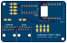
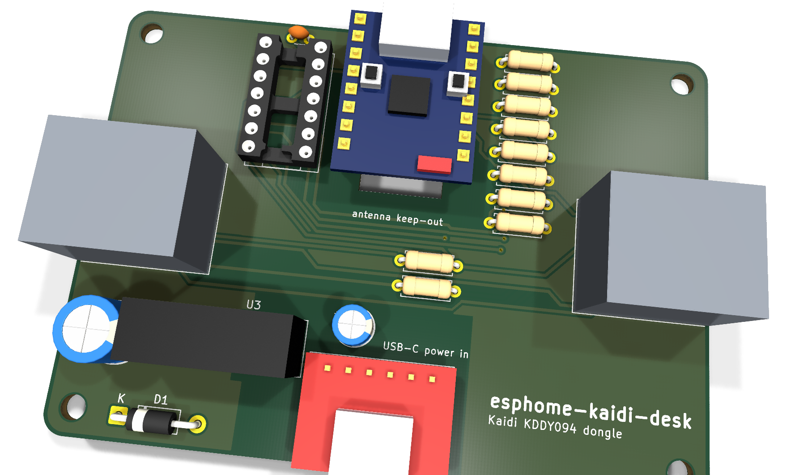
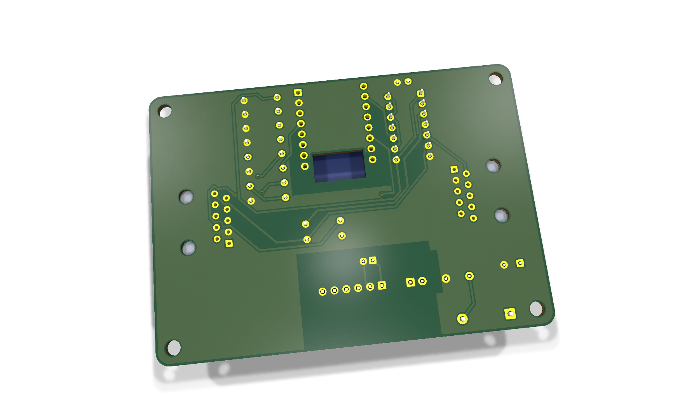
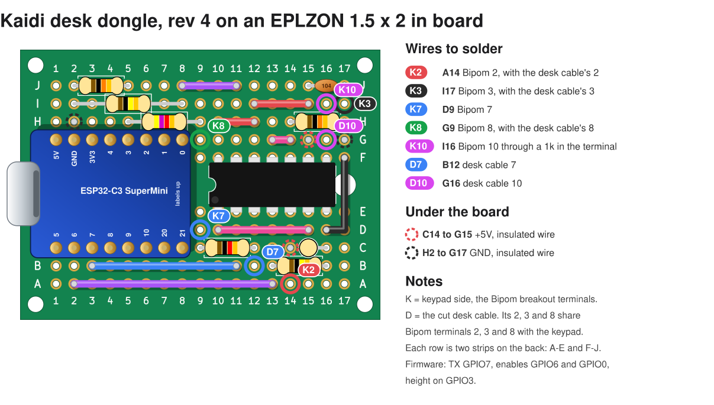

# esphome-kaidi-desk

[](https://github.com/clintval/esphome-kaidi-desk/actions/workflows/ci.yml?query=branch%3Amain)
[](https://esphome.io/components/external_components.html)
[](LICENSE)

Control a Kaidi standing desk from Home Assistant with an ESP32 and ESPHome.

<p align="center">
  
  
</p>

## Introduction

Many budget electric standing desks, sit-stand desks and desk frames run on a control box from Kaidi (Changzhou Kaidi Electrical), such as the `KDDY094`, which talks to its keypad over 9600 baud serial on a 10-pin RJ50 cable.
This component reads the desk's height and moves it the way the keypad does, including the reset that clears E04.

To check your desk, look for a `KAIDI` label and a `KDDY` model number on the control box under the desktop.

| Desk | Control box | Status |
| --- | --- | --- |
| ApexDesk K Series 3-stage dual-motor desk base | `KDDY094` | Tested |
| Desks with a `KDDY094` box (variants S440, S500, S650 and S663) | `KDDY094` | Expected to work |
| Desks with a `KDDY041` box and `KD1869A` keypad | `KDDY041` | Same protocol, but an 8-pin cable, so the dongle won't fit |

If your desk works, please open an issue or pull request to add it.

## Quick Start

Add the component to an ESPHome config and wire the dongle as in [Hardware](#hardware):

```yaml
external_components:
  - source: github://clintval/esphome-kaidi-desk@main
    components: [kaidi_desk]

uart:
  rx_pin: GPIO4
  tx_pin: GPIO7
  baud_rate: 9600

kaidi_desk:
  tx_enable_pin: GPIO6
  wake_pin: GPIO10
  keypad_sense_pin: GPIO3

sensor:
  - platform: kaidi_desk
    height:
      name: Height

number:
  - platform: kaidi_desk
    target_height:
      name: Target Height
      unit_of_measurement: in
```

A complete config with every entity is in [`example/kaidi-desk.yaml`](example/kaidi-desk.yaml).

## Entities

| Platform | Key | Purpose |
| --- | --- | --- |
| `sensor` | `height` | Height above the desk's lowest point, in cm (Home Assistant converts units) |
| `text_sensor` | `status` | `Ready`, `Reset Needed` (E04), `Resetting`, or `Asleep` |
| `text_sensor` | `last_stop` | Why the last move ended, such as `Reached target`, `Reached preset 2`, `Stopped`, `Stopped short at a limit or obstruction` or `Lost the height` |
| `number` | `target_height` | Move to a height; follows the real height while idle, in `cm` or `in` |
| `button` | `nudge_up`, `nudge_down` | Move briefly up or down, about half an inch |
| `button` | `stop` | Stop any move |
| `button` | `preset_1` to `preset_4` | Go to a position saved on the keypad; the box drives there and stops by itself |
| `button` | `reset` | Hold Up and Down until the box re-zeros, which clears E04 |
| `switch` | `keep_awake` | Hold the wake line high and send a few Idle frames every 10 s, so the box never sleeps, height streams live and moves start at once |

## Hardware

> [!WARNING]
> This board revision is untested. The isolation test, the measurements of the USB-C breakout and the B0505S-2WR3, and the RJ50 jack fit check are still pending, so don't order boards from it yet.
> The [protoboard build](#build-without-a-pcb) is tested and works.

The dongle sits inline: the keypad plugs into one end, and a short cable runs from the other end to the control box.
A 74AHCT125 drives the box only while the ESP is sending, so the keypad keeps working if the ESP is unplugged or dead.
Power comes in on the board's own USB-C through an isolated converter, so any USB charger works.

<p align="center">
  
  
</p>

<p align="center">
  
  
</p>

<details>
<summary>Schematic</summary>

<p align="center">
  
</p>

</details>

| RJ50 contact | Signal | Path |
| --- | --- | --- |
| 2 | +5 V | Straight through; also powers the 74AHCT125 |
| 3 | Ground | Straight through |
| 7 | Command, keypad to box | Keypad through 1 kΩ; gate A drives the box side from GPIO7 when GPIO6 is high |
| 8 | Height, box to keypad | Straight through; 10 kΩ over 15 kΩ to GPIO4 |
| 10 | Wake, keypad to box | Keypad through 1 kΩ; gate B drives the box side high when GPIO10 is high |

The board is an 84 × 50 mm, two-layer, all through-hole KiCad design in [`hardware/`](hardware).
Power comes in on a USB-C breakout (J3) standing on a 1 × 6 header at the board's bottom edge, then through a Mornsun B0505S-2WR3 isolated converter (U3) and a 1N5819 Schottky diode (D1) to the C3's 5V pin.
The converter keeps the charger's ground apart from the desk's, so any USB charger works, two-prong ones included.
Without it, a two-prong charger leaks a little mains AC onto the desk's ground, which upsets touch-sensitive keypads: they barely register a press and the desk creeps a millimeter at a time.
The charger side of the board (J3, the input capacitor C3 and the converter's pins 1 and 2) has its own copper, with no ground pour and a moat no other trace crosses.
The ESP32-C3 SuperMini plugs into two round-pin socket strips, so it can be pulled out; the desk's 5 V can't supply its Wi-Fi current, so it never powers the C3.
Its own USB-C is only for the first flash, with the board out of the box, and ESPHome updates over Wi-Fi after that. The diode makes it harmless to have both USB-C ports plugged in.
The breakout's outline is estimated from photos, so check it against your part in [`scripts/dimensions.py`](scripts/dimensions.py) before ordering.
To solder the C3 flat instead, set `C3_BOTTOM = 0.2` in the same file and run `pixi run hardware`.

## Enclosure

A two-part, 89 × 55 × 24 mm box is in [`hardware/enclosure/`](hardware/enclosure) as STEP and STL, sized to sit in the desk's cable tray beside the control box.
Its only USB-C opening lines up with the power breakout; the C3's own port stays inside.

<p align="center">
  
  
</p>

Press the two heat-set inserts into the base with a soldering iron at about 220 °C, set the board on its posts, and screw the lid down with two M3 × 20 mm socket-head cap screws, which sit flush in the lid.
Print it in MJF nylon or, at home, PETG; resin tends to crack around the inserts.

## Bill of Materials

| Qty | Part | Where to order |
| --- | --- | --- |
| 1 | PCB, 84 × 50 mm, 2 layers, 1.6 mm | [JLCPCB](https://jlcpcb.com/): upload [`hardware/kaidi-desk-gerbers.zip`](hardware/kaidi-desk-gerbers.zip) |
| 1 | Enclosure base and lid, MJF nylon (PA12) | [JLCPCB 3D printing](https://jlcpcb.com/3d-printing): upload [`base.stl`](hardware/enclosure/base.stl) and [`lid.stl`](hardware/enclosure/lid.stl) |
| 2 | Amphenol/FCI 54602-910LF, 10P10C right-angle jack (J1, J2) | [DigiKey](https://www.digikey.com/en/products/detail/amphenol-cs-fci/54602-910LF/1001361) |
| 1 | SN74AHCT125N quad buffer, DIP-14 (U2) | [DigiKey](https://www.digikey.com/en/products/result?keywords=SN74AHCT125N) |
| 1 | DIP-14 socket, 0.3 in (optional) | [DigiKey](https://www.digikey.com/en/products/result?keywords=DIP-14%20socket%200.3) |
| 1 | ESP32-C3 SuperMini (U1) | [Amazon](https://www.amazon.com/s?k=ESP32-C3+SuperMini) or [AliExpress](https://www.aliexpress.us/w/wholesale-esp32-c3-supermini.html) |
| 2 | Mill-Max 310-43-108-41-001000, 8-pin round socket strip (U1) | [DigiKey ED6264-08-ND](https://www.digikey.com/en/products/result?keywords=310-43-108-41-001000) |
| 2 | Mill-Max 350-10-108-00-006000, 8-pin round male strip, soldered to the C3 (U1) | [DigiKey ED6864-08-ND](https://www.digikey.com/en/products/result?keywords=350-10-108-00-006000) |
| 2 | 1 kΩ, 1/4 W (R1, R2) | [DigiKey CF14JT1K00](https://www.digikey.com/en/products/result?keywords=CF14JT1K00) |
| 5 | 10 kΩ, 1/4 W (R3, R4, R5, R7, R9) | [DigiKey CF14JT10K0](https://www.digikey.com/en/products/result?keywords=CF14JT10K0) |
| 1 | 100 kΩ, 1/4 W (R6) | [DigiKey CF14JT100K](https://www.digikey.com/en/products/result?keywords=CF14JT100K) |
| 2 | 15 kΩ, 1/4 W (R8, R10) | [DigiKey CF14JT15K0](https://www.digikey.com/en/products/result?keywords=CF14JT15K0) |
| 1 | 100 nF ceramic, 2.5 mm lead pitch (C1) | [DigiKey](https://www.digikey.com/en/products/result?keywords=100nF%2050V%20ceramic%20radial%202.5mm) |
| 1 | Cermant USB-C female breakout with 5.1 kΩ on CC (J3) | [Amazon](https://www.amazon.com/s?k=Cermant+Type-C+female+breakout+16P) |
| 1 | 1 × 6 male pin header, 2.54 mm, for the breakout (J3) | Any header strip, cut to length |
| 1 | Mornsun B0505S-2WR3 isolated 5 V to 5 V converter, 2 W, SIP (U3) | [DigiKey](https://www.digikey.com/en/products/result?keywords=B0505S-2WR3) or [Amazon](https://www.amazon.com/s?k=B0505S-2WR3) |
| 1 | 220 µF 16 V electrolytic, 6.3 mm, 2.5 mm lead pitch (C2) | [DigiKey](https://www.digikey.com/en/products/result?keywords=220uF%2016V%20radial%206.3mm) |
| 1 | 10 µF 16 V electrolytic, 5 mm, 2 mm lead pitch (C3, converter input) | [DigiKey](https://www.digikey.com/en/products/result?keywords=10uF%2016V%20radial%205mm) |
| 1 | 1N5819 Schottky diode, DO-41, mounted standing (D1) | [DigiKey](https://www.digikey.com/en/products/result?keywords=1N5819) |
| 1 | RJ50 (10P10C) cable, about 1 ft, wired straight through, dongle to control box | [Winford CBM10R1TS-1](https://www.winford.com/products/cbm10.php) (US) or [Delock 80185](https://www.delock.com/produkt/80185/merkmale.html) (EU) |
| 2 | M3 × 20 mm socket-head cap screw, ISO 4762 | [Amazon](https://www.amazon.com/s?k=M3x20+socket+head+cap+screw+ISO+4762+stainless) |
| 2 | M3 heat-set insert, 5.7 mm long, 4.0 mm hole (ruthex M3) | [Amazon](https://www.amazon.com/s?k=ruthex+M3+heat+set+inserts) |

The cable must be wired straight through; flat telephone-style 10P10C cables are often reversed.

## Build Without a PCB

The protoboard build is the same circuit hand-built on a 1.5 × 2 in EPLZON solderable breadboard, with a Bipom BRK10P10CSJ breakout for the keypad and a cut 10P10C cable to the desk.

> [!IMPORTANT]
> Power the protoboard build from a grounded (three-prong) USB charger, a computer's USB port or a power bank.
> It has no isolated power input, so a two-prong charger leaks a little mains AC onto the desk's ground and touch-sensitive keypads barely register a press.

<p align="center">
  
</p>

On this build, configure `tx_enable_pin: GPIO6`, `wake_pin: GPIO0` and `rx_pin: GPIO3`, and leave out `keypad_sense_pin`.

## Protocol

Each frame is 7 bytes, `0x68 0x01 <mode> <hi> <lo> <checksum> 0x16`, where the checksum is the low byte of `0x01 + mode + hi + lo`.

| Direction | Mode | Meaning |
| --- | --- | --- |
| Keypad to box | `0x01` | Up |
| Keypad to box | `0x02` | Down |
| Keypad to box | `0x03` | Idle |
| Keypad to box | `0x04` | Up and Down held (reset) |
| Keypad to box | `0x06` to `0x09` | Go to preset 1 to 4, repeated until the box stops |
| Box to keypad | `0x00` | Height in 0.1 cm |
| Box to keypad | `0x30` | Reset needed (E04); the value counts down during the reset |
| Box to keypad | `0x04` | Reset rebound in progress |

The keypad sends a frame every 14 ms while awake, and the box needs about 1.5 s after waking before it accepts a move.
E04 means a reset was released before the rebound.

## Development and Testing

See the [contributing guide](./CONTRIBUTING.md) for more information.

## Acknowledgements

The frame format was first decoded in [`xvzf/kaidi-desk-controller-protocol`](https://github.com/xvzf/kaidi-desk-controller-protocol), and [`jcappaert/esphome-kaidi`](https://github.com/jcappaert/esphome-kaidi) read the height on the same `KDDY094` box.
The preset commands were documented by [`yog18r/kaidi-desk-esphome`](https://github.com/yog18r/kaidi-desk-esphome), a separate desk-powered board for the same box.

## License

MIT
