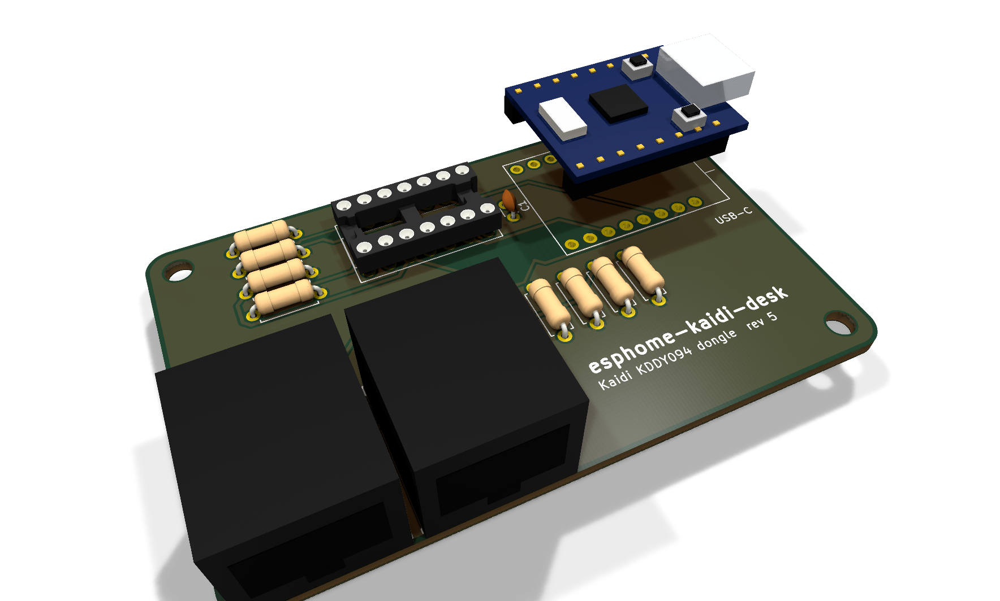
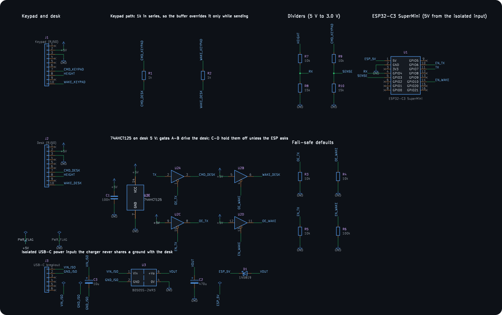
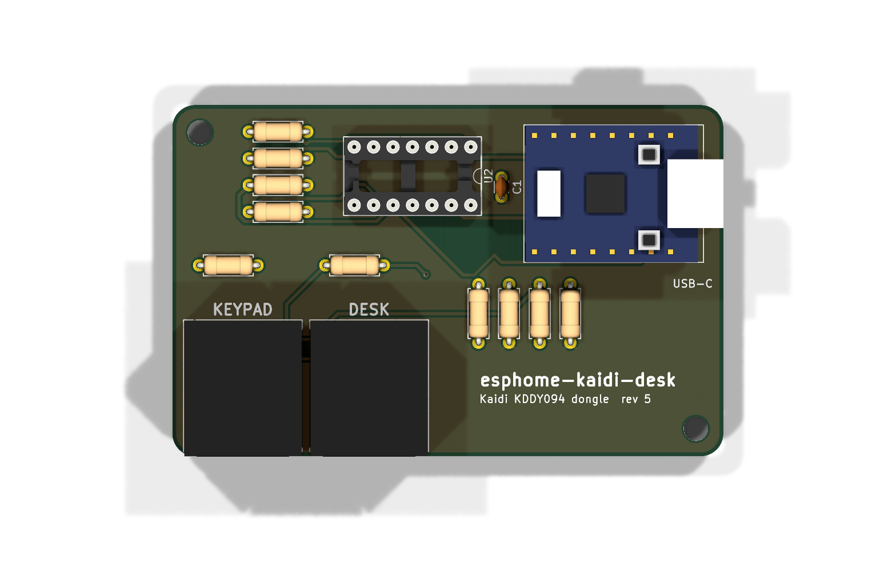

# esphome-kaidi-desk

[](https://github.com/clintval/esphome-kaidi-desk/actions/workflows/ci.yml?query=branch%3Amain)
[](https://esphome.io/components/external_components.html)
[](LICENSE)

Control a Kaidi standing desk from Home Assistant with an ESP32 and ESPHome.



## Introduction

Many "K Series" and other budget standing desks run on a Kaidi control box, such as the `KDDY094`.
The box talks to its keypad over a 9600 baud serial link on a 10-pin RJ50 cable, and no off-the-shelf smart-desk dongle speaks its protocol.
This component reads the desk's height and drives it the way the keypad does: it raises the keypad's wake line to power the motors, waits for the box to settle, then streams Up, Down and Reset commands.
Earlier Kaidi projects only listened to the box; moving the desk needed the wake line on contact 10, which an 8-pin RJ45 plug cannot reach.

## Quick Start

Add the component to an ESPHome config and wire the dongle as in [Hardware](#hardware):

```yaml
external_components:
  - source: github://clintval/esphome-kaidi-desk@main
    components: [kaidi_desk]

uart:
  rx_pin: GPIO4
  tx_pin: GPIO7
  baud_rate: 9600

kaidi_desk:
  tx_enable_pin: GPIO6
  wake_pin: GPIO10
  keypad_sense_pin: GPIO3

sensor:
  - platform: kaidi_desk
    height:
      name: Height

number:
  - platform: kaidi_desk
    target_height:
      name: Target Height
      unit_of_measurement: in
```

A complete config for an ESP32-C3 SuperMini, with every entity, is in [`example/kaidi-desk.yaml`](example/kaidi-desk.yaml).
Once flashed, the board appears in Home Assistant through the ESPHome integration.

## Entities

| Platform | Key | Purpose |
| --- | --- | --- |
| `sensor` | `height` | Height above the desk's lowest point, in cm (Home Assistant converts units) |
| `text_sensor` | `status` | `Ready`, `Reset Needed` (E04), `Resetting`, or `Asleep` |
| `number` | `target_height` | Move to a height; follows the real height while idle, in `cm` or `in` |
| `button` | `nudge_up`, `nudge_down` | Move briefly up or down, about half an inch |
| `button` | `stop` | Stop any move |
| `button` | `reset` | Hold Up and Down until the box re-zeros, which clears E04 |
| `switch` | `keep_awake` | Hold the wake line high so height streams live and moves start at once |

## Hardware

The dongle sits inline between the keypad and the control box: the keypad plugs into one RJ50 jack and a straight-through 10P10C cable runs from the other to the box.
Power, ground and the height stream pass straight through.
The keypad's command and wake lines reach the box through 1 kΩ resistors, and a 74AHCT125, powered from the desk's 5 V, drives the box side only while the ESP is sending.
Its two spare gates hold the driving gates off unless the ESP raises GPIO6 or GPIO10, so the keypad keeps working when the ESP is unplugged, rebooting or dead.
Dividers bring the box's 5 V height stream and the keypad's command line down to about 3.1 V for GPIO4 and GPIO3, so a keypad press hands the desk straight back to you.



| RJ50 contact | Signal | Path |
| --- | --- | --- |
| 2 | +5 V | Straight through; also powers the 74AHCT125 |
| 3 | Ground | Straight through |
| 7 | Command, keypad to box | Keypad through 1 kΩ; gate A drives the box side from GPIO7 when GPIO6 is high |
| 8 | Height, box to keypad | Straight through; 10 kΩ over 15 kΩ to GPIO4 |
| 10 | Wake, keypad to box | Keypad through 1 kΩ; gate B drives the box side high when GPIO10 is high |

The board is a 72 × 46 mm two-layer KiCad design in [`hardware/`](hardware), with all parts through-hole: two Amphenol/FCI 54602-910LF right-angle jacks, a 74AHCT125 in a DIP-14 socket, 1/4 W resistors, a 100 nF capacitor and two 1×8 female headers for an ESP32-C3 SuperMini with its headers on the underside.
Upload [`hardware/kaidi-desk-gerbers.zip`](hardware/kaidi-desk-gerbers.zip) to a board house such as JLCPCB to order it.
The jack footprint follows FCI drawing C-BMJ-0101 rev F; confirm pin 1 against your jacks before ordering.



## Protocol

Each frame is 7 bytes, `0x68 0x01 <mode> <hi> <lo> <checksum> 0x16`, where the checksum is the low byte of `0x01 + mode + hi + lo`.

| Direction | Mode | Meaning |
| --- | --- | --- |
| Keypad to box | `0x01` | Up |
| Keypad to box | `0x02` | Down |
| Keypad to box | `0x03` | Idle |
| Keypad to box | `0x04` | Up and Down held (reset) |
| Box to keypad | `0x00` | Height in 0.1 cm |
| Box to keypad | `0x30` | Reset needed (E04); the value counts down during the reset |
| Box to keypad | `0x04` | Reset rebound in progress |

The keypad sends a frame every 14 ms while awake.
The box answers about 0.6 s after it wakes, ignores moves for about 1 s more, and needs Up held about 0.4 s before the motors start.
It displays E04 when a reset is released before the rebound.

## Development and Testing

See the [contributing guide](./CONTRIBUTING.md) for more information.

## Acknowledgements

The frame format was first decoded in [`xvzf/kaidi-desk-controller-protocol`](https://github.com/xvzf/kaidi-desk-controller-protocol), and [`jcappaert/esphome-kaidi`](https://github.com/jcappaert/esphome-kaidi) read the height on the same `KDDY094` box.

## License

MIT
